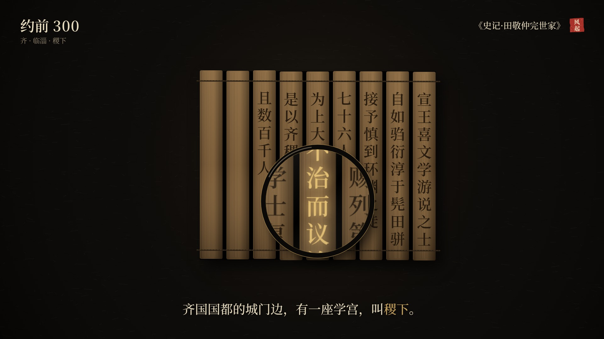

# Liber Ventorum · 风起之书



**风起之书** is the visual style of the Douyin / YouTube / TikTok series 《风起之书》 by 壹几星纪 (Yiduo Xiao): short history films about what one person can do when an era changes, framed by the 800-year rhythm of Jupiter–Saturn conjunctions.

It is a custom style for [Lemo-Opuscar](https://github.com/lemomo-ai/lemo-opuscar), the code-rendered film toolkit for Claude Code: every frame is drawn in code (Canvas 2D), rendered headless, and assembled with ffmpeg. No video generation and no stock footage.

一盏灯下的器物、滚动的年份路标、盖印的出处卡；木星与土星相遇时，一阵风把一个时代吹进下一个时代。

## The look

| | |
|---|---|
| Ground | warm black `#0E0C0A` under one low lamp |
| Gold `#C9A45C` | only the thing being read: a keyword, a planet, a decisive number or character |
| Seal red `#A8322A` | the source seal, and one turning point per film |
| Year stamp | top left, year · place, rolls like an odometer when time moves |
| Source card | top right, the original book title + a red seal 风起 |
| Captions | the only voice: one line, Noto Serif SC 40 px, gold keywords, paced by reading time |
| Signature move | **the wind**: Jupiter and Saturn meet, the old era blows into light and settles into the next era's object |
| Sound | silent master; music is added on each platform |

Full rules: [`STYLE.md`](STYLE.md). Decisions and why: [`CHANGES.md`](CHANGES.md). Demo: [`DEMO.md`](DEMO.md), facts: [`FACTS.md`](FACTS.md).

## Demo

`test.mp4`: 第一次起风 · 前 464 (38 s). The sky rolls back to 464 BCE, the wind turns the stars into bamboo slips from 稷下, a loupe finds 不治而议论, and 荀子's 天行有常 lights up character by character.

## Use it

1. Install Lemo-Opuscar in Claude Code:
   ```
   claude plugin marketplace add lemomo-ai/lemo-opuscar
   claude plugin install lemo-opuscar@lemolab
   ```
2. Copy this folder to `~/lemo-my-styles/liber-ventorum/` and add a row for it in `~/lemo-my-styles/README.md`.
3. Ask for a film: `/lemo-opuscar:lemo-opuscar 用我的风格 liber-ventorum 做一集：……`

Rebuild the demo: `LIB=~/lemo-opuscar sh demo/build.sh` (Node 20+, ffmpeg, Python 3.11+).

## Credits

Built on [Lemo-Opuscar](https://github.com/lemomo-ai/lemo-opuscar) (MIT) techniques from *Visual Investigation*, *Archive Light Table* and *Data Storytelling*. Fonts: Noto Serif SC, Cormorant SC, IBM Plex Mono (SIL OFL 1.1). Planet positions computed with PyEphem. See [`demo/CREDITS`](demo/CREDITS).

Code: MIT. Fonts: their own OFL licences.
